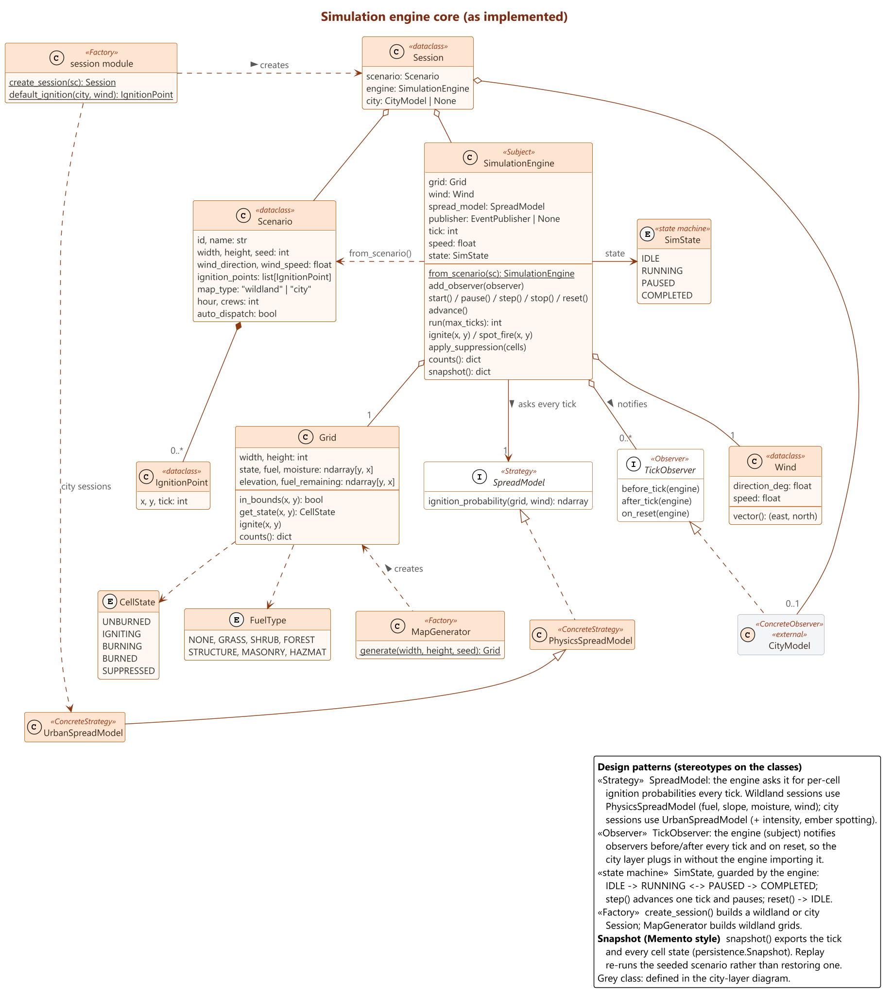
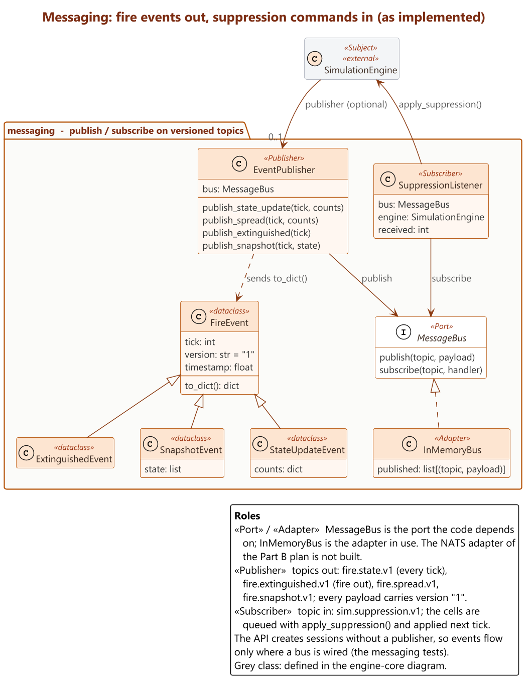
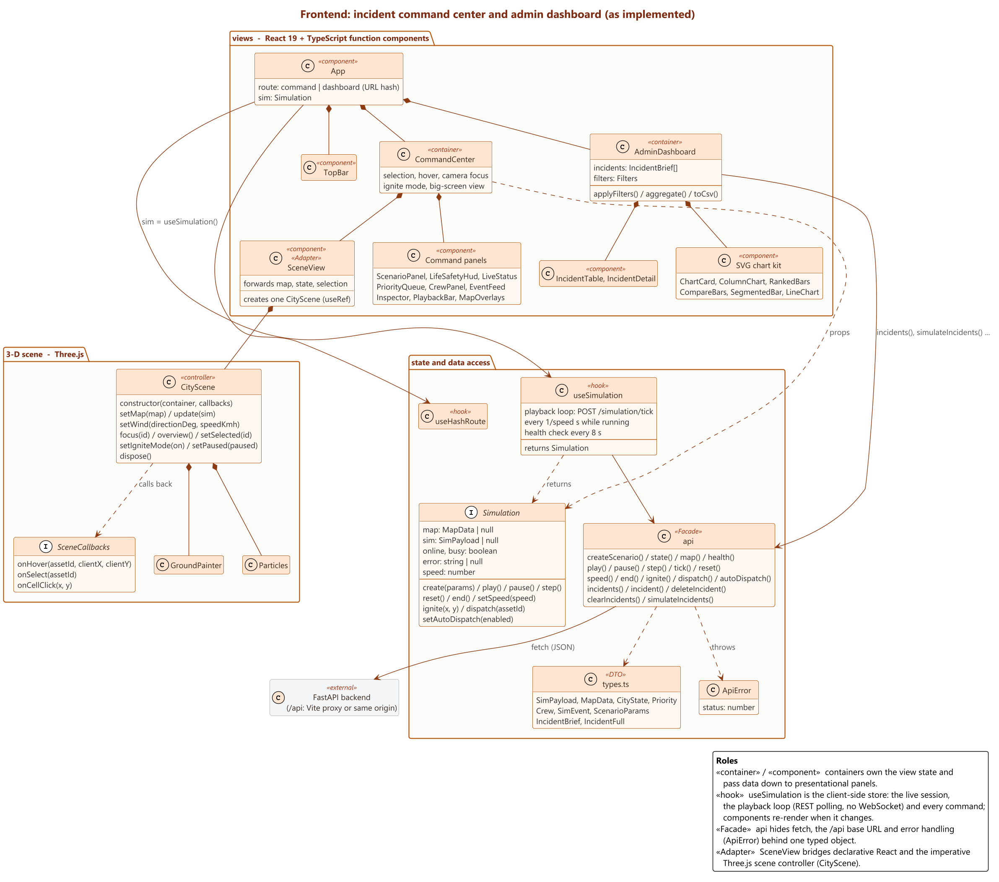
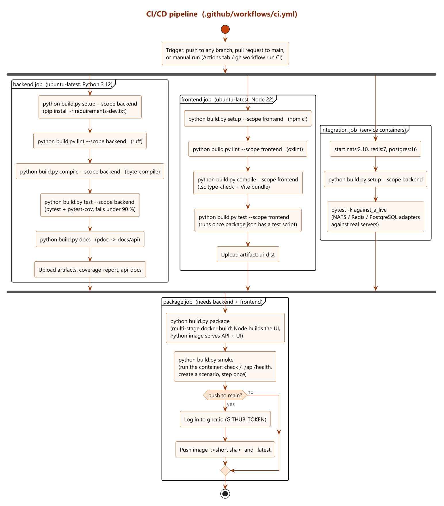

# FireSimulator — Project Part C Report

**CSYE 7230 · Fireforce6 · Team A** — Aditi Jaiswal, Mohammad Adnaan Mansuri

Repository: https://github.com/jaiswaladitneu/FireSimulator
Wiki (User Manual): https://github.com/jaiswaladitneu/FireSimulator/wiki
CI pipeline: https://github.com/jaiswaladitneu/FireSimulator/actions/workflows/ci.yml

---

## 1. Final Design

**Acting on the Part B feedback.** This iteration adds a numbered requirement-traceability table
(§1.3), shows how the design patterns are *selected and exercised at runtime* (§1.4), restates the
nonfunctional goals as *measurable* criteria (§1.5), and backs every feature with code, tests and
peer-reviewed per-story pull requests (§3, §6).

### 1.1 Changes since Part B

**Problem space**

| Area | Part B plan | Final state | Reason |
|---|---|---|---|
| Functional scope | Wildland fire spread on a terrain grid, scenario CRUD, playback, replay | Kept, plus a **city incident-command layer**: a procedural town, a people model (who is where by time of day, evacuation, rescue, estimated casualties), life-safety priority ranking, fire-crew dispatch (manual and automatic), and an incident history | Fire spread alone gave a commander nothing to act on; the city layer turns the simulator into a decision tool |
| New user role | Operator only | Operator plus **administrator** (Admin Dashboard: incident history, analytics, batch simulation, CSV export) | Comparing past incidents was a recurring stakeholder request |
| Epic E5 (UI) | Babylon.js 3-D terrain, WebSocket live feed, 2-D canvas fallback | **Three.js** 3-D town with a **WebSocket live feed** (`WS /simulation/ws`, server-pushed frames, HTTP-polling fallback) and a **2-D canvas fallback** when WebGL is unavailable (`?view=2d`) | Three.js replaced Babylon.js; the feed and fallback were completed after the core shipped |
| Epic E6 (Persistence) | PostgreSQL schema, Redis cache | **Repository** ports with in-memory, **JSON-file** and **PostgreSQL** implementations; an optional **Redis** live-state cache; periodic **snapshots** saved during a run for resync/replay | The JSON-file single container is the default for easy grading; PostgreSQL (`FIRESIM_DATABASE_URL`) and Redis (`FIRESIM_REDIS_URL`) switch on via environment variables |
| Epic E3 (Messaging) | NATS adapter | `MessageBus` **port** with an in-memory adapter **and a NATS adapter** (`FIRESIM_NATS_URL`), verified against a real NATS server in CI | The in-memory bus stays the default; NATS is available for exchanging fire events with other Fireforce6 components |
| Non-functional | Reproducible runs, ≥ 80 % test coverage | Reproducible runs (seeded RNG), **≥ 90 % branch coverage enforced in CI** (currently 98 %), live-integration tests against real NATS/Redis/PostgreSQL in CI, single-command build and deployment | Quality bar raised once the build script and CI existed |

**Solution space.** The layered **Ports and Adapters** architecture from Part B is unchanged. The city
features were added *without modifying the wildland engine*: the town attaches to the engine as a tick
**Observer** and supplies its own spread **Strategy** (`UrbanSpreadModel`). The API now also serves the
built UI, so the whole app ships as one Docker image (Figure 1). The NATS, Redis and PostgreSQL
adapters plug in behind the existing `MessageBus`, `StateCache` and `Repository` ports, chosen by
environment variables, so the default single container is unchanged.

*Figure 1: Deployed architecture: one container (FastAPI + built React UI) with a mounted volume for
incident history. Source: https://github.com/jaiswaladitneu/FireSimulator/blob/main/docs/design/architecture.puml*

### 1.2 Class diagrams (as implemented)

The diagrams are PlantUML, drawn from the final code and showing only the important classes.
Stereotypes (`<<Strategy>>`, `<<Subject>>`/`<<Observer>>`, `<<Port>>`/`<<Adapter>>`, `<<Repository>>`,
`<<Facade>>`, `<<Factory>>`, `<<Memento>>` …) mark the role each class plays.

*Figure 2: Engine core. `SimulationEngine` <<Subject>> delegates spread to a `SpreadModel`
<<Strategy>> (`PhysicsSpreadModel`, `UrbanSpreadModel` <<ConcreteStrategy>>) and notifies
`TickObserver`s; `MapGenerator` and the session module are <<Factory>>s. Technology: Python 3.12,
NumPy (vectorized grid).*

*Figure 3: City layer. `CityMapGenerator` <<Factory>> builds the seeded town; `CityModel`
<<ConcreteObserver>> updates people, priorities and crews on every engine tick. Technology: Python,
NumPy.*

*Figure 4: Messaging. `MessageBus` <<Port>> with `InMemoryBus` <<Adapter>> (and a `NatsBus` <<Adapter>>
for a real NATS server); `EventPublisher` <<Publisher>> and `SuppressionListener` <<Subscriber>>
exchange events on versioned topics (`fire.*.v1`).*

*Figure 5: API and persistence. FastAPI routes (<<Facade>>) take `ScenarioIn` <<DTO>> and drive the
engine `Session`; `ApiPrefixMiddleware` serves every route under `/api` as well; `ScenarioRepository`,
`SnapshotRepository` and `IncidentRepository` <<Repository>> have in-memory, JSON-file and PostgreSQL
implementations; a `StateCache` <<Port>> (in-memory or Redis) caches the latest live state; `Snapshot`
is a <<Memento>>. Technology: FastAPI, Pydantic, Uvicorn.*

*Figure 6: Frontend. `CommandCenter` and `AdminDashboard` <<container>>s, `useSimulation`
<<hook>> holding the live state, `api` client <<Facade>> over the REST API, `CityScene`
<<controller>> for the Three.js scene. Technology: React 19, TypeScript, Vite, Three.js.*

### 1.3 Requirement traceability

Each functional requirement maps to the design element that realizes it and to the test and pull
request that provide evidence (the Part B feedback asked for this table).

| # | Functional requirement | Realized by (design · code) | Evidence (test · PR) |
|---|---|---|---|
| FR-1 | Advance the fire tick by tick on a grid | `SimulationEngine` «Subject» · `engine/engine.py` | T1 `test_engine.py` · #38 |
| FR-2 | Physics spread biased by wind, slope, fuel, moisture | `PhysicsSpreadModel` «Strategy» · `engine/spread.py`, `wind.py` | T2 `test_spread.py` · #38 |
| FR-3 | Urban spread with embers through the town | `UrbanSpreadModel` «Strategy» · `engine/spread.py` | `test_city.py` · #42 |
| FR-4 | Scenario create/list/get/delete with validation | FastAPI routes «Facade», `ScenarioIn` «DTO» · `api/main.py` | T5 `test_api_errors.py` · #38 |
| FR-5 | Playback: play / pause / step / speed / reset | `SimState` lifecycle · `api/main.py` | `test_api.py` · #42 |
| FR-6 | Deterministic replay of a saved scenario | seeded RNG + `Session` «Factory» · `engine/session.py` | T1 `test_engine.py` · #40 |
| FR-7 | People model: occupancy, evacuation, casualties | `CityModel` «Observer», `population.py` · `engine/` | T3 `test_city.py` · #42 |
| FR-8 | Life-safety priority ranking and crew dispatch | `ResponseManager`, `Crew` · `engine/response.py` | T4 `test_city.py` · #42 |
| FR-9 | Incident history, analytics and CSV export | `IncidentRepository` «Repository» · `persistence/`, `frontend/.../stats.ts` | T8 `stats.test.ts` · #42, #44 |
| FR-10 | Inbound suppression over the message bus | `MessageBus` «Port», `SuppressionListener` · `messaging/` | T6 `test_messaging.py` · #39 |
| FR-11 | Fire events on versioned topics; periodic snapshots | `EventPublisher`, `SnapshotEvent`, `SnapshotArchiver` · `messaging/`, `persistence/recorder.py` | `test_messaging.py`, `test_snapshots_api.py` · #46 |
| FR-12 | Late-join resync | `GET /simulation/resync` · `api/main.py` | `test_snapshots_api.py` · #46 |
| FR-13 | Live state feed to the UI | `WS /simulation/ws` · `api/main.py`, `frontend/src/api/liveFeed.ts` | `test_ws_feed.py`, `liveFeed.test.ts` · #47 |
| FR-14 | Interoperable message transport (NATS) | `NatsBus` «Adapter» · `messaging/nats_bus.py` | `test_nats_bus.py` (live) · #48 |
| FR-15 | Durable, shareable persistence (PostgreSQL) | `PostgresStore` «Repository» · `persistence/postgres.py` | `test_postgres.py` (live) · #50 |
| FR-16 | Shared live-state cache (Redis) | `StateCache` «Port», `RedisStateCache` · `persistence/cache.py` | `test_cache.py` (live) · #49 |
| FR-17 | 3-D command center and 2-D fallback view | `CityScene`, `Scene2D` · `frontend/src/` | `fallback2d.test.ts` · #42, #51 |

### 1.4 Design patterns, selected and exercised at runtime

Part B named the patterns; this section shows how each is *chosen and used at runtime*.

- **Strategy — spread model.** `create_session` picks `UrbanSpreadModel` for a `map_type: "city"`
  scenario and `PhysicsSpreadModel` otherwise; every `advance()` calls
  `spread_model.ignition_probability(grid, wind)`, so the physics can be swapped without touching the
  engine.
- **Adapter — message bus.** `_make_bus()` returns a `NatsBus` when `FIRESIM_NATS_URL` is set, else an
  `InMemoryBus`; `EventPublisher` and `SuppressionListener` depend only on the `MessageBus` port.
- **Repository — persistence.** `_make_repositories()` returns in-memory, JSON-file or PostgreSQL
  repositories from `FIRESIM_DATABASE_URL`; the API never names a concrete repository.
- **Adapter — state cache.** `_make_state_cache()` returns an in-memory cache or `RedisStateCache`
  from `FIRESIM_REDIS_URL`.
- **Observer — tick loop.** `CityModel` attaches to the engine and updates people, priorities and crews
  every tick; the engine also publishes a state update each tick and a snapshot every *N* ticks, which
  a subscribed `SnapshotArchiver` persists.

**Suppression interaction (command → effect → event).** A `POST /simulation/suppress` request (or an
inbound `sim.suppression.v1` message) is validated and its cells are queued with
`engine.apply_suppression`. On the next `advance()` the engine marks those cells `SUPPRESSED`,
increments the tick, notifies observers (the city updates crews and losses), checks for completion, and
the publisher emits a `fire.state.v1` update and, periodically, a `fire.snapshot.v1` snapshot that the
archiver saves for resync. This is the runtime interaction the Part B feedback asked to see.

### 1.5 Nonfunctional requirements (measurable)

| Property | Criterion | Result |
|---|---|---|
| Reproducibility | Same scenario + seed → identical grid after 50 ticks | ✔ T1 (`np.array_equal`) |
| Tick duration | A tick finishes well inside the 1 s-per-tick playback budget | 3.3 ms (120²), 11.6 ms (200²), 62 ms (400²) on a dev laptop |
| Grid size | Supported map size per side | 1–400 cells (city ≥ 48); out-of-range rejected with HTTP 422 |
| Test coverage | Branch coverage enforced in CI | ≥ 90 % gate; **98 %** (2,205 statements, 410 branches) |
| Message handling | Fire events delivered on versioned topics | synchronous in-memory bus; NATS adapter round-trip verified against a real server in CI |
| Failure recovery | A cache or service outage must not break the run | state-cache writes are wrapped in `try/except`; unset `FIRESIM_*` variables fall back to in-memory / JSON-file defaults |

**Fully working vs optional.** Everything in the default container is fully working and demonstrated:
the engine, city layer, 3-D and 2-D UI, snapshots, the WebSocket feed and the incident history. NATS,
Redis and PostgreSQL are *optional* integrations — off by default, switched on by an environment
variable. None is mocked: each has a real adapter verified against a real server by the CI integration
job (§3, §4.2).

## 2. API Documentation

Every public module, class and method in the backend has a Google-style docstring (arguments,
return value, raised exceptions). The HTML reference is generated with **pdoc**
(`python build.py docs`) and committed to the repository:

- Folder: https://github.com/jaiswaladitneu/FireSimulator/tree/main/docs/api
- Entry page: https://github.com/jaiswaladitneu/FireSimulator/blob/main/docs/api/index.html
- How to view it locally: https://github.com/jaiswaladitneu/FireSimulator/blob/main/docs/README.md

The REST endpoints are also documented interactively by FastAPI's Swagger UI at
`http://localhost:8000/docs` on a running server.

## 3. Test Cases

### 3.1 Strategy and frameworks

- **Backend — pytest + pytest-cov.** 112 tests in https://github.com/jaiswaladitneu/FireSimulator/tree/main/tests
  (109 unit/API tests plus 3 live-integration tests).
  *Unit tests* drive the engine, spread models, city layer, messaging and repositories directly.
  *API tests* use FastAPI's `TestClient` to call every endpoint, including error paths
  (409 conflicts, 404 not found, 422 validation errors, via `pytest.mark.parametrize`). Randomness is
  controlled with fixed seeds so every test is deterministic.
- **Integration tests — real servers.** The NATS, Redis and PostgreSQL adapters are exercised against
  **real servers** (`nats:2.10`, `redis:7`, `postgres:16`) by a dedicated CI job that starts them as
  service containers; the same tests are skipped locally unless `FIRESIM_NATS_URL`,
  `FIRESIM_REDIS_URL` or `FIRESIM_DATABASE_URL` is set, and the adapter logic also has in-process
  fakes so coverage holds without a server.
- **Frontend — Vitest.** 50 tests in 6 files cover the logic behind the dashboards and the new UI
  transport:
  formatting (https://github.com/jaiswaladitneu/FireSimulator/blob/main/frontend/src/lib/format.test.ts),
  Admin Dashboard filters, KPI aggregates and CSV export
  (https://github.com/jaiswaladitneu/FireSimulator/blob/main/frontend/src/lib/stats.test.ts),
  compass names and life-safety ordering
  (https://github.com/jaiswaladitneu/FireSimulator/blob/main/frontend/src/lib/kinds.test.ts),
  chart axis scaling
  (https://github.com/jaiswaladitneu/FireSimulator/blob/main/frontend/src/components/dashboard/chartUtils.test.ts),
  the WebSocket live-feed URL derivation
  (https://github.com/jaiswaladitneu/FireSimulator/blob/main/frontend/src/api/liveFeed.test.ts),
  and the 2-D fallback cell colours and grid drawing
  (https://github.com/jaiswaladitneu/FireSimulator/blob/main/frontend/src/scene/fallback2d.test.ts).
  Time-dependent tests pass a fixed "now" so they are deterministic.
- **Coverage analysis.** Branch coverage is measured by `coverage.py`. `pyproject.toml` sets
  `fail_under = 90`, so the build **fails** if coverage drops. Current result: **98 %**
  (2,205 statements, 410 branches). The HTML report (`htmlcov/`) and `coverage.xml` are uploaded as
  CI artifacts, and the coverage table is written to the CI run summary.
- **System level.** `python build.py smoke` starts the Docker image and checks the UI, `/api/health`,
  scenario creation and one simulation step.

### 3.2 Selected test cases and oracles

| # | Test (code link) | What it verifies | Oracle: pass ✔ / fail ✘ |
|---|---|---|---|
| T1 | `test_runs_are_reproducible_with_same_seed` — https://github.com/jaiswaladitneu/FireSimulator/blob/main/tests/test_engine.py#L46 | Two engines built from the same scenario and seed produce the same fire after 50 ticks (replay depends on this) | ✔ the two `grid.state` arrays are identical (`np.array_equal`) · ✘ any cell differs |
| T2 | `test_wind_biases_spread_downwind` — https://github.com/jaiswaladitneu/FireSimulator/blob/main/tests/test_spread.py#L20 | Physics spread model: a 40 km/h east wind (90°) favours downwind cells | ✔ ignition probability of the east neighbour > the west neighbour · ✘ otherwise |
| T3 | `test_people_are_conserved_through_a_whole_incident` — https://github.com/jaiswaladitneu/FireSimulator/blob/main/tests/test_city.py#L92 | People model invariant over a 600-tick incident: nobody appears or disappears | ✔ for every cell, occupants + evacuated + casualties = initial occupants · ✘ any cell breaks the equation |
| T4 | `test_dispatched_crew_travels_then_suppresses` — https://github.com/jaiswaladitneu/FireSimulator/blob/main/tests/test_city.py#L146 | Crew dispatch: a crew sent to a burning house is `en_route`, travels, then suppresses fire | ✔ status `en_route` on dispatch, and after travel time `cells_suppressed > 0` and some cell is `SUPPRESSED` · ✘ no crew assigned or nothing suppressed |
| T5 | `test_invalid_scenarios_are_rejected` (5 parametrized cases) — https://github.com/jaiswaladitneu/FireSimulator/blob/main/tests/test_api_errors.py#L41 | REST validation: width 0, height 401, unknown map type, hour 24, missing name | ✔ `POST /scenarios` returns HTTP 422 · ✘ any other status code |
| T6 | `test_suppression_listener_applies_cells_to_engine` — https://github.com/jaiswaladitneu/FireSimulator/blob/main/tests/test_messaging.py#L36 | A suppression command published on the bus reaches the engine | ✔ listener counts 1 message, and after one tick cell (2,2) is `SUPPRESSED` · ✘ message lost or cell still burning |
| T7 | `Time formatting` suite — https://github.com/jaiswaladitneu/FireSimulator/blob/main/frontend/src/lib/format.test.ts#L46 | Incident clock wraps correctly | ✔ `fmtHour(8)='08:00'`, `fmtHour(24)='00:00'`, `fmtHour(-1)='23:00'` · ✘ any other string |
| T8 | `averages outcomes per response type` — https://github.com/jaiswaladitneu/FireSimulator/blob/main/frontend/src/lib/stats.test.ts | Admin Dashboard compares automatic and manual dispatch | ✔ for 2 auto incidents (4 and 2 casualties) and 1 manual (9), auto = `{n:2, casualties:3, …}` and manual = `{n:1, casualties:9, …}` · ✘ any other value |

A test passes when every assertion holds. pytest/Vitest report a failure, with the expected and actual
values, as soon as any assertion fails, and that also fails the CI job.

## 4. CI/CD

### 4.1 Build script

https://github.com/jaiswaladitneu/FireSimulator/blob/main/build.py is one cross-platform Python script,
invoked as `python build.py <command> [--scope all|backend|frontend]`:

| Goal | Command | What runs |
|---|---|---|
| Install | `setup` | `pip install -r requirements-dev.txt`, `npm ci` |
| Lint | `lint` | `ruff check .`, `oxlint` |
| Compile | `compile` | byte-compile all Python; `tsc` type-check + Vite bundle into `frontend/dist` |
| Test | `test` | `pytest` with branch coverage (fails below 90 %); `vitest run` |
| Document | `docs` | pdoc regenerates `docs/api` |
| Package | `package` | multi-stage Docker build → image `firesim:local` |
| Verify | `smoke` | runs the container and calls the UI, health, scenario and step endpoints |
| Deploy | `deploy` / `stop` | `docker compose up/down` (infra/docker-compose.yml) on http://localhost:8000 |
| Shortcuts | `ci`, `all` | `ci` = lint compile test docs; `all` = ci + package + smoke |

The README documents how to trigger every goal:
https://github.com/jaiswaladitneu/FireSimulator/blob/main/README.md#build-test-and-deploy

### 4.2 Pipeline

Pipeline script: https://github.com/jaiswaladitneu/FireSimulator/blob/main/.github/workflows/ci.yml
(GitHub Actions).

- **Triggers:** every push to any branch, every pull request to `main`, and manual runs
  (`workflow_dispatch`). A newer push cancels the run in progress on the same branch.
- **Jobs / containers:** all run on `ubuntu-latest` GitHub-hosted runners and call `build.py`.
  - `backend` (Python 3.12): setup → lint → compile → test → docs. Outputs: `coverage-report` and
    `api-docs` artifacts, plus a coverage table in the run summary.
  - `frontend` (Node 22): setup → lint → compile → test. Output: `ui-dist` artifact.
  - `integration`: starts `nats:2.10`, `redis:7` and `postgres:16` as service containers and runs the
    NATS, Redis and PostgreSQL adapter round-trip tests against them (the real-server verification).
  - `package` (needs both): builds the Docker image, smoke-tests the container, and on `main` only
    pushes `ghcr.io/jaiswaladitneu/firesimulator:latest` and `:<short-sha>` to GitHub Container
    Registry (continuous delivery).
- **Status:** the latest runs on `main` and on feature branches all passed.

*Figure 7: CI/CD pipeline: triggers, the parallel backend and frontend jobs, packaging, smoke test
and image publication. Source: https://github.com/jaiswaladitneu/FireSimulator/blob/main/docs/design/ci-pipeline.puml*

## 5. User Manual

The User Manual is on the repository wiki: https://github.com/jaiswaladitneu/FireSimulator/wiki

It covers system requirements, **installation and deployment** (Docker and from source), creating an
incident, the Command Center HUD, simulation controls, manual and automatic crew dispatch, the Admin
Dashboard (batch simulation, CSV export) and troubleshooting, each with step lists and screenshots.

## 6. Scrum Summary (since Part B)

Sprint board: https://github.com/jaiswaladitneu/FireSimulator/milestones ·
Epics: https://github.com/jaiswaladitneu/FireSimulator/issues?q=label%3Aepic

### Sprint 2 — Messaging & data (Nov 2 – Nov 16)

- **Summary:** inbound messaging and replay were completed: suppression commands arrive through the
  bus, and saved scenarios replay deterministically. A first React control dashboard went in.
- **Stories finished:** #24 Deterministic replay (PR https://github.com/jaiswaladitneu/FireSimulator/pull/40),
  #28 Suppression listener (PR https://github.com/jaiswaladitneu/FireSimulator/pull/39),
  #26 Versioned fire-event topics (PR #38). #27 Snapshot event and #30 Periodic snapshots were
  scaffolded in PR #38 (event, publisher method and repository) and completed later — see
  *Deferred stories* below. First UI: PR https://github.com/jaiswaladitneu/FireSimulator/pull/41.
- **Contributions:** *Mohammad Adnaan Mansuri* — replay endpoint, suppression listener, reviews.
  *Aditi Jaiswal* — React control dashboard (scenario form, playback controls, live statistics).
- **Notes:** the NATS adapter (#25) and PostgreSQL (#29) were postponed in favour of the in-memory
  bus and JSON-file repositories (see §1.1); both were completed later — see *Deferred stories* below.

### Sprint 3 — Visualization, replay & polish (Nov 16 – Nov 30)

- **Summary:** the UI was rebuilt as a 3-D incident command center with a city layer (town, people,
  priorities, crews) and an Admin Dashboard. The project got full docstrings, generated API docs,
  98 % backend coverage, frontend unit tests, a build script, a Docker image and a CI/CD pipeline
  that publishes it.
- **Stories finished:** #33 App shell & scenario forms, #34 Playback controls & live statistics,
  #35 3-D rendering (Three.js), #31 Save & replay; quality stories in E7 (#10, #11).
  PRs: https://github.com/jaiswaladitneu/FireSimulator/pull/42,
  https://github.com/jaiswaladitneu/FireSimulator/pull/43,
  https://github.com/jaiswaladitneu/FireSimulator/pull/44.
- **Contributions:** *Mohammad Adnaan Mansuri* — city layer, 3-D command center, admin dashboard,
  API docs, coverage tests, build script, Dockerfile, CI/CD, design diagrams.
  *Aditi Jaiswal* — Vitest set-up and 39 frontend unit tests (formatting, dashboard filters, KPIs, CSV export, chart scales), User Manual (wiki), PR reviews.
- **Notes:** the work was scoped around one deployable container so the final demo runs with one command.

### Deferred stories — completed after the core

After the one-container product shipped, the stories that had been postponed, replaced or dropped were
implemented behind the existing ports and merged to `main` — so nothing was left out:

| Story | Delivered | PR |
|---|---|---|
| #27 Periodic snapshot event · #30 Periodic snapshotting | Runs emit a periodic `SnapshotEvent` and persist snapshots; `GET /scenarios/{id}/snapshots` and `GET /simulation/resync` serve them | https://github.com/jaiswaladitneu/FireSimulator/pull/46 |
| #36 WebSocket live state feed | `WS /simulation/ws` streams server-advanced frames; the UI uses it with an HTTP-polling fallback | https://github.com/jaiswaladitneu/FireSimulator/pull/47 |
| #25 NATS adapter | `NatsBus` implements the `MessageBus` port over nats-py (`FIRESIM_NATS_URL`) | https://github.com/jaiswaladitneu/FireSimulator/pull/48 |
| #32 Redis live-state cache | `StateCache` port with an in-memory default and a Redis adapter (`FIRESIM_REDIS_URL`) | https://github.com/jaiswaladitneu/FireSimulator/pull/49 |
| #29 PostgreSQL schema & repositories | `PostgresStore` implements the scenario, snapshot and incident ports (`FIRESIM_DATABASE_URL`) | https://github.com/jaiswaladitneu/FireSimulator/pull/50 |
| #37 2-D canvas fallback view | A 2-D canvas view of the grid when WebGL is unavailable or `?view=2d` is set | https://github.com/jaiswaladitneu/FireSimulator/pull/51 |

The NATS, Redis and PostgreSQL adapters are verified against real servers by the CI `integration` job.
All defaults are unchanged, so the demo still runs as one container (`python build.py deploy`).

**Process (acting on the Part B feedback).** Each of these stories was delivered as its own
peer-reviewed pull request (#46–#52), and the issue tracker is reconciled with the work: **0 open
issues**, delivered stories closed as *completed* and the postponed ones reopened and then completed —
so the sprint board matches the repository.
