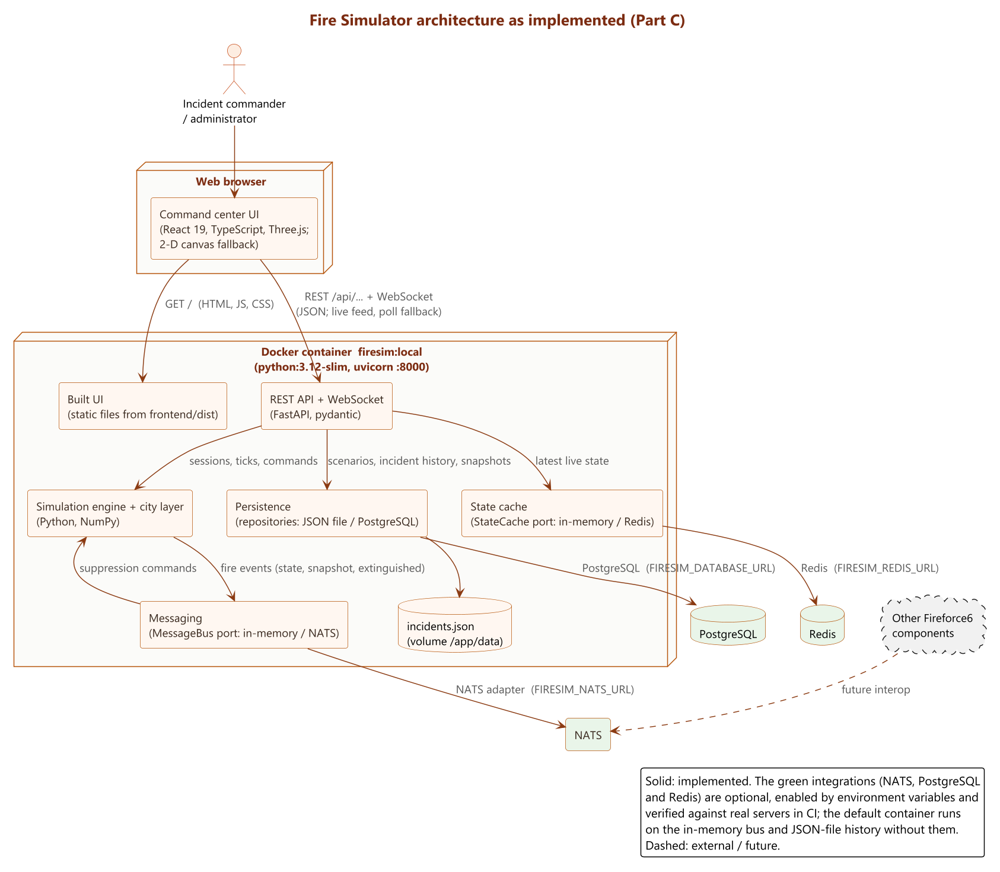
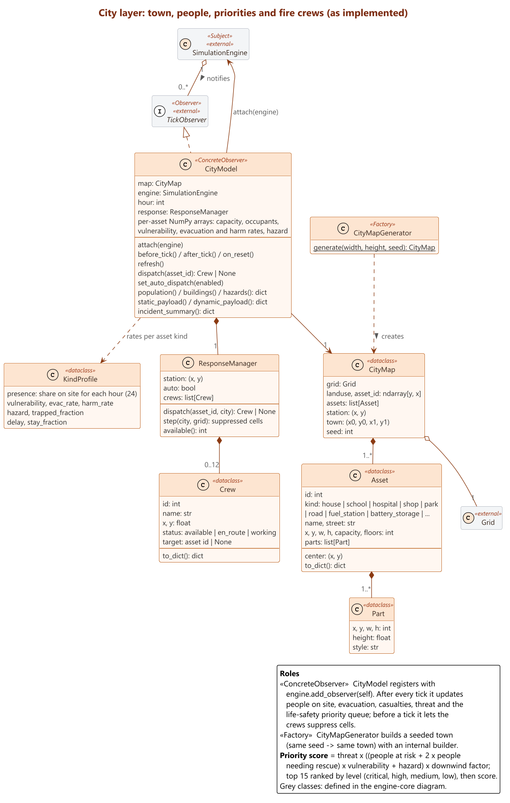
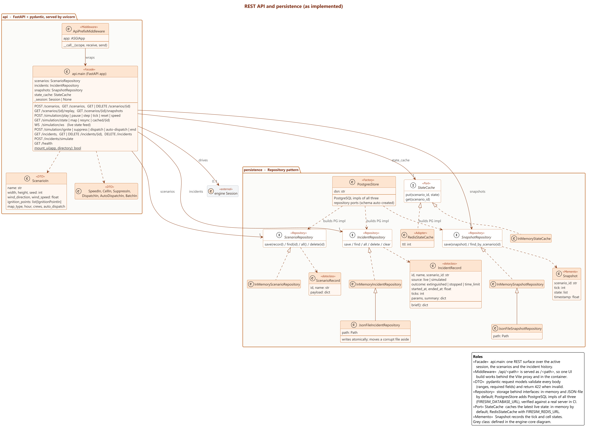

# FireSimulator — Project Part C Report

**CSYE 7230 · Fireforce6 · Team A** — Aditi Jaiswal, Mohammad Adnaan Mansuri

Repository: https://github.com/jaiswaladitneu/FireSimulator
Wiki (User Manual): https://github.com/jaiswaladitneu/FireSimulator/wiki
CI pipeline: https://github.com/jaiswaladitneu/FireSimulator/actions/workflows/ci.yml

---

## 1. Final Design

### 1.1 Changes since Part B

**Problem space**

| Area | Part B plan | Final state | Reason |
|---|---|---|---|
| Functional scope | Wildland fire spread on a terrain grid, scenario CRUD, playback, replay | Kept, plus a **city incident-command layer**: a procedural town, a people model (who is where by time of day, evacuation, rescue, estimated casualties), life-safety priority ranking, fire-crew dispatch (manual and automatic), and an incident history | Fire spread alone gave a commander nothing to act on; the city layer turns the simulator into a decision tool |
| New user role | Operator only | Operator plus **administrator** (Admin Dashboard: incident history, analytics, batch simulation, CSV export) | Comparing past incidents was a recurring stakeholder request |
| Epic E5 (UI) | Babylon.js 3-D terrain, WebSocket live feed, 2-D canvas fallback | **Three.js** 3-D town, state fetched by **HTTP polling**; 2-D fallback dropped | Three.js was enough for the scene, and polling at playback speed met the latency need with less code |
| Epic E6 (Persistence) | PostgreSQL schema, Redis cache | **Repository** interfaces with in-memory and **JSON-file** implementations; Redis dropped | A single Docker container is simpler to deploy and grade; the Repository port leaves room for PostgreSQL later |
| Epic E3 (Messaging) | NATS adapter | `MessageBus` **port** with an in-memory adapter; NATS adapter postponed | No other Fireforce6 component was ready to exchange messages yet |
| Non-functional | Reproducible runs, ≥ 80 % test coverage | Reproducible runs (seeded RNG), **≥ 90 % branch coverage enforced in CI** (currently 98 %), single-command build and deployment | Quality bar raised once the build script and CI existed |

**Solution space.** The layered **Ports and Adapters** architecture from Part B is unchanged. The city
features were added *without modifying the wildland engine*: the town attaches to the engine as a tick
**Observer** and supplies its own spread **Strategy** (`UrbanSpreadModel`). The API now also serves the
built UI, so the whole app ships as one Docker image (Figure 1).

*Figure 1: Deployed architecture: one container (FastAPI + built React UI) with a mounted volume for
incident history. Source: https://github.com/jaiswaladitneu/FireSimulator/blob/main/docs/design/architecture.puml*

### 1.2 Class diagrams (as implemented)

The diagrams are PlantUML, drawn from the final code and showing only the important classes.
Stereotypes (`<<Strategy>>`, `<<Subject>>`/`<<Observer>>`, `<<Port>>`/`<<Adapter>>`, `<<Repository>>`,
`<<Facade>>`, `<<Factory>>`, `<<Memento>>` …) mark the role each class plays.

*Figure 2: Engine core. `SimulationEngine` <<Subject>> delegates spread to a `SpreadModel`
<<Strategy>> (`PhysicsSpreadModel`, `UrbanSpreadModel` <<ConcreteStrategy>>) and notifies
`TickObserver`s; `MapGenerator` and the session module are <<Factory>>s. Technology: Python 3.12,
NumPy (vectorized grid).*

*Figure 3: City layer. `CityMapGenerator` <<Factory>> builds the seeded town; `CityModel`
<<ConcreteObserver>> updates people, priorities and crews on every engine tick. Technology: Python,
NumPy.*

*Figure 4: Messaging. `MessageBus` <<Port>> with `InMemoryBus` <<Adapter>>; `EventPublisher`
<<Publisher>> and `SuppressionListener` <<Subscriber>> exchange events on versioned topics
(`fire.*.v1`).*

*Figure 5: API and persistence. FastAPI routes (<<Facade>>) take `ScenarioIn` <<DTO>> and drive the
engine `Session`; `ApiPrefixMiddleware` serves every route under `/api` as well; `ScenarioRepository`,
`SnapshotRepository` and `IncidentRepository` <<Repository>> have in-memory and JSON-file
implementations; `Snapshot` is a <<Memento>>. Technology: FastAPI, Pydantic, Uvicorn.*

*Figure 6: Frontend. `CommandCenter` and `AdminDashboard` <<container>>s, `useSimulation`
<<hook>> holding the live state, `api` client <<Facade>> over the REST API, `CityScene`
<<controller>> for the Three.js scene. Technology: React 19, TypeScript, Vite, Three.js.*

## 2. API Documentation

Every public module, class and method in the backend has a Google-style docstring (arguments,
return value, raised exceptions). The HTML reference is generated with **pdoc**
(`python build.py docs`) and committed to the repository:

- Folder: https://github.com/jaiswaladitneu/FireSimulator/tree/main/docs/api
- Entry page: https://github.com/jaiswaladitneu/FireSimulator/blob/main/docs/api/index.html
- How to view it locally: https://github.com/jaiswaladitneu/FireSimulator/blob/main/docs/README.md

The REST endpoints are also documented interactively by FastAPI's Swagger UI at
`http://localhost:8000/docs` on a running server.

## 3. Test Cases

### 3.1 Strategy and frameworks

- **Backend — pytest + pytest-cov.** 82 tests in https://github.com/jaiswaladitneu/FireSimulator/tree/main/tests.
  *Unit tests* drive the engine, spread models, city layer, messaging and repositories directly.
  *API tests* use FastAPI's `TestClient` to call every endpoint, including error paths
  (409 conflicts, 404 not found, 422 validation errors, via `pytest.mark.parametrize`). Randomness is
  controlled with fixed seeds so every test is deterministic.
- **Frontend — Vitest.** 39 tests in 4 files cover the logic behind the dashboards:
  formatting (https://github.com/jaiswaladitneu/FireSimulator/blob/main/frontend/src/lib/format.test.ts),
  Admin Dashboard filters, KPI aggregates and CSV export
  (https://github.com/jaiswaladitneu/FireSimulator/blob/main/frontend/src/lib/stats.test.ts),
  compass names and life-safety ordering
  (https://github.com/jaiswaladitneu/FireSimulator/blob/main/frontend/src/lib/kinds.test.ts),
  and chart axis scaling
  (https://github.com/jaiswaladitneu/FireSimulator/blob/main/frontend/src/components/dashboard/chartUtils.test.ts).
  Time-dependent tests pass a fixed "now" so they are deterministic.
- **Coverage analysis.** Branch coverage is measured by `coverage.py`. `pyproject.toml` sets
  `fail_under = 90`, so the build **fails** if coverage drops. Current result: **98.2 %**
  (1,931 statements, 380 branches). The HTML report (`htmlcov/`) and `coverage.xml` are uploaded as
  CI artifacts, and the coverage table is written to the CI run summary.
- **System level.** `python build.py smoke` starts the Docker image and checks the UI, `/api/health`,
  scenario creation and one simulation step.

### 3.2 Selected test cases and oracles

| # | Test (code link) | What it verifies | Oracle: pass ✔ / fail ✘ |
|---|---|---|---|
| T1 | `test_runs_are_reproducible_with_same_seed` — https://github.com/jaiswaladitneu/FireSimulator/blob/main/tests/test_engine.py#L46 | Two engines built from the same scenario and seed produce the same fire after 50 ticks (replay depends on this) | ✔ the two `grid.state` arrays are identical (`np.array_equal`) · ✘ any cell differs |
| T2 | `test_wind_biases_spread_downwind` — https://github.com/jaiswaladitneu/FireSimulator/blob/main/tests/test_spread.py#L20 | Physics spread model: a 40 km/h east wind (90°) favours downwind cells | ✔ ignition probability of the east neighbour > the west neighbour · ✘ otherwise |
| T3 | `test_people_are_conserved_through_a_whole_incident` — https://github.com/jaiswaladitneu/FireSimulator/blob/main/tests/test_city.py#L92 | People model invariant over a 600-tick incident: nobody appears or disappears | ✔ for every cell, occupants + evacuated + casualties = initial occupants · ✘ any cell breaks the equation |
| T4 | `test_dispatched_crew_travels_then_suppresses` — https://github.com/jaiswaladitneu/FireSimulator/blob/main/tests/test_city.py#L146 | Crew dispatch: a crew sent to a burning house is `en_route`, travels, then suppresses fire | ✔ status `en_route` on dispatch, and after travel time `cells_suppressed > 0` and some cell is `SUPPRESSED` · ✘ no crew assigned or nothing suppressed |
| T5 | `test_invalid_scenarios_are_rejected` (5 parametrized cases) — https://github.com/jaiswaladitneu/FireSimulator/blob/main/tests/test_api_errors.py#L41 | REST validation: width 0, height 401, unknown map type, hour 24, missing name | ✔ `POST /scenarios` returns HTTP 422 · ✘ any other status code |
| T6 | `test_suppression_listener_applies_cells_to_engine` — https://github.com/jaiswaladitneu/FireSimulator/blob/main/tests/test_messaging.py#L36 | A suppression command published on the bus reaches the engine | ✔ listener counts 1 message, and after one tick cell (2,2) is `SUPPRESSED` · ✘ message lost or cell still burning |
| T7 | `Time formatting` suite — https://github.com/jaiswaladitneu/FireSimulator/blob/main/frontend/src/lib/format.test.ts#L46 | Incident clock wraps correctly | ✔ `fmtHour(8)='08:00'`, `fmtHour(24)='00:00'`, `fmtHour(-1)='23:00'` · ✘ any other string |
| T8 | `averages outcomes per response type` — https://github.com/jaiswaladitneu/FireSimulator/blob/main/frontend/src/lib/stats.test.ts | Admin Dashboard compares automatic and manual dispatch | ✔ for 2 auto incidents (4 and 2 casualties) and 1 manual (9), auto = `{n:2, casualties:3, …}` and manual = `{n:1, casualties:9, …}` · ✘ any other value |

A test passes when every assertion holds. pytest/Vitest report a failure, with the expected and actual
values, as soon as any assertion fails, and that also fails the CI job.

## 4. CI/CD

### 4.1 Build script

https://github.com/jaiswaladitneu/FireSimulator/blob/main/build.py is one cross-platform Python script,
invoked as `python build.py <command> [--scope all|backend|frontend]`:

| Goal | Command | What runs |
|---|---|---|
| Install | `setup` | `pip install -r requirements-dev.txt`, `npm ci` |
| Lint | `lint` | `ruff check .`, `oxlint` |
| Compile | `compile` | byte-compile all Python; `tsc` type-check + Vite bundle into `frontend/dist` |
| Test | `test` | `pytest` with branch coverage (fails below 90 %); `vitest run` |
| Document | `docs` | pdoc regenerates `docs/api` |
| Package | `package` | multi-stage Docker build → image `firesim:local` |
| Verify | `smoke` | runs the container and calls the UI, health, scenario and step endpoints |
| Deploy | `deploy` / `stop` | `docker compose up/down` (infra/docker-compose.yml) on http://localhost:8000 |
| Shortcuts | `ci`, `all` | `ci` = lint compile test docs; `all` = ci + package + smoke |

The README documents how to trigger every goal:
https://github.com/jaiswaladitneu/FireSimulator/blob/main/README.md#build-test-and-deploy

### 4.2 Pipeline

Pipeline script: https://github.com/jaiswaladitneu/FireSimulator/blob/main/.github/workflows/ci.yml
(GitHub Actions).

- **Triggers:** every push to any branch, every pull request to `main`, and manual runs
  (`workflow_dispatch`). A newer push cancels the run in progress on the same branch.
- **Jobs / containers:** all run on `ubuntu-latest` GitHub-hosted runners and call `build.py`.
  - `backend` (Python 3.12): setup → lint → compile → test → docs. Outputs: `coverage-report` and
    `api-docs` artifacts, plus a coverage table in the run summary.
  - `frontend` (Node 22): setup → lint → compile → test. Output: `ui-dist` artifact.
  - `package` (needs both): builds the Docker image, smoke-tests the container, and on `main` only
    pushes `ghcr.io/jaiswaladitneu/firesimulator:latest` and `:<short-sha>` to GitHub Container
    Registry (continuous delivery).
- **Status:** the latest runs on `main` and on feature branches all passed.

*Figure 7: CI/CD pipeline: triggers, the parallel backend and frontend jobs, packaging, smoke test
and image publication. Source: https://github.com/jaiswaladitneu/FireSimulator/blob/main/docs/design/ci-pipeline.puml*

## 5. User Manual

The User Manual is on the repository wiki: https://github.com/jaiswaladitneu/FireSimulator/wiki

It covers system requirements, **installation and deployment** (Docker and from source), creating an
incident, the Command Center HUD, simulation controls, manual and automatic crew dispatch, the Admin
Dashboard (batch simulation, CSV export) and troubleshooting, each with step lists and screenshots.

## 6. Scrum Summary (since Part B)

Sprint board: https://github.com/jaiswaladitneu/FireSimulator/milestones ·
Epics: https://github.com/jaiswaladitneu/FireSimulator/issues?q=label%3Aepic

### Sprint 2 — Messaging & data (Nov 2 – Nov 16)

- **Summary:** inbound messaging and replay were completed: suppression commands arrive through the
  bus, and saved scenarios replay deterministically. A first React control dashboard went in.
- **Stories finished:** #24 Deterministic replay (PR https://github.com/jaiswaladitneu/FireSimulator/pull/40),
  #28 Suppression listener (PR https://github.com/jaiswaladitneu/FireSimulator/pull/39),
  #26 Versioned fire-event topics, #27 Snapshot event, #30 Periodic snapshots (delivered in PR #38).
  First UI: PR https://github.com/jaiswaladitneu/FireSimulator/pull/41.
- **Contributions:** *Mohammad Adnaan Mansuri* — replay endpoint, suppression listener, reviews.
  *Aditi Jaiswal* — React control dashboard (scenario form, playback controls, live statistics).
- **Notes:** the NATS adapter (#25) and PostgreSQL (#29) were postponed in favour of the in-memory
  bus and JSON-file repositories (see §1.1).

### Sprint 3 — Visualization, replay & polish (Nov 16 – Nov 30)

- **Summary:** the UI was rebuilt as a 3-D incident command center with a city layer (town, people,
  priorities, crews) and an Admin Dashboard. The project got full docstrings, generated API docs,
  98 % backend coverage, frontend unit tests, a build script, a Docker image and a CI/CD pipeline
  that publishes it.
- **Stories finished:** #33 App shell & scenario forms, #34 Playback controls & live statistics,
  #35 3-D rendering (Three.js), #31 Save & replay; quality stories in E7 (#10, #11).
  PRs: https://github.com/jaiswaladitneu/FireSimulator/pull/42,
  https://github.com/jaiswaladitneu/FireSimulator/pull/43,
  https://github.com/jaiswaladitneu/FireSimulator/pull/44.
- **Contributions:** *Mohammad Adnaan Mansuri* — city layer, 3-D command center, admin dashboard,
  API docs, coverage tests, build script, Dockerfile, CI/CD, design diagrams.
  *Aditi Jaiswal* — Vitest set-up and 39 frontend unit tests (formatting, dashboard filters, KPIs, CSV export, chart scales), User Manual (wiki), PR reviews.
- **Notes:** the work was scoped around one deployable container so the final demo runs with one command.

### Not done (lack of time)

| Story | Status |
|---|---|
| #25 NATS adapter behind the `MessageBus` port | Postponed; the port and in-memory adapter are in place |
| #29 PostgreSQL schema & repositories | Replaced by JSON-file repositories behind the same interface |
| #32 Redis live-state cache (optional) | Dropped |
| #36 WebSocket live state feed | Replaced by HTTP polling |
| #37 2-D canvas fallback view (stretch) | Dropped |
